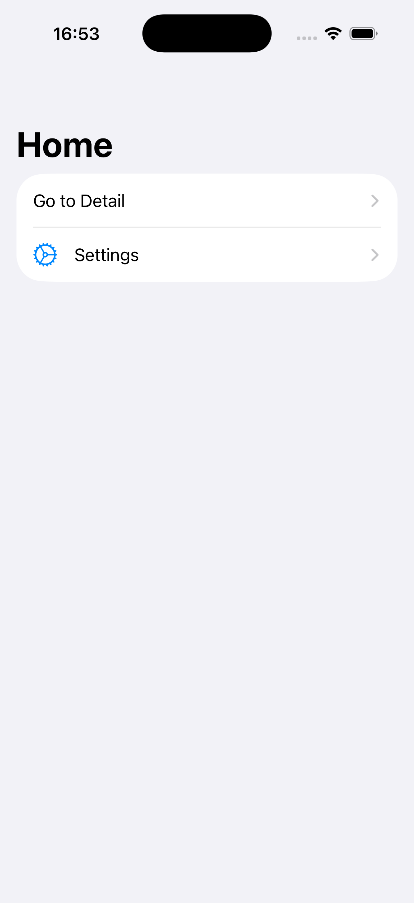
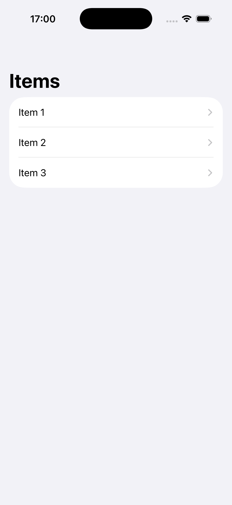
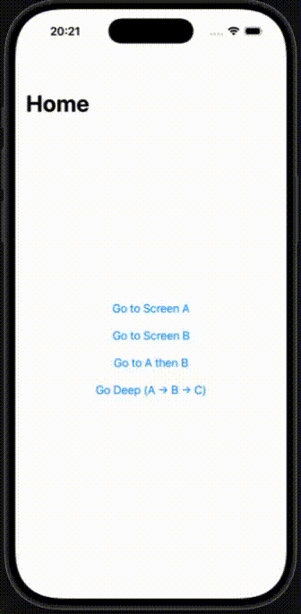
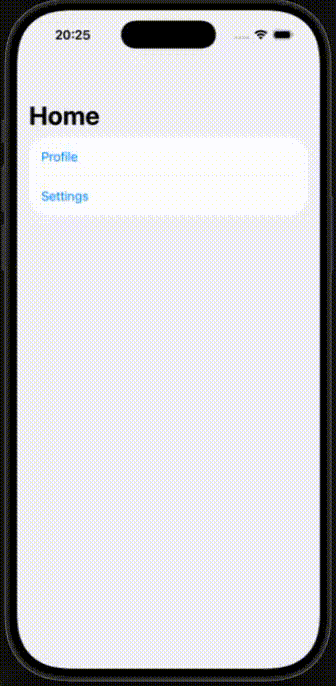
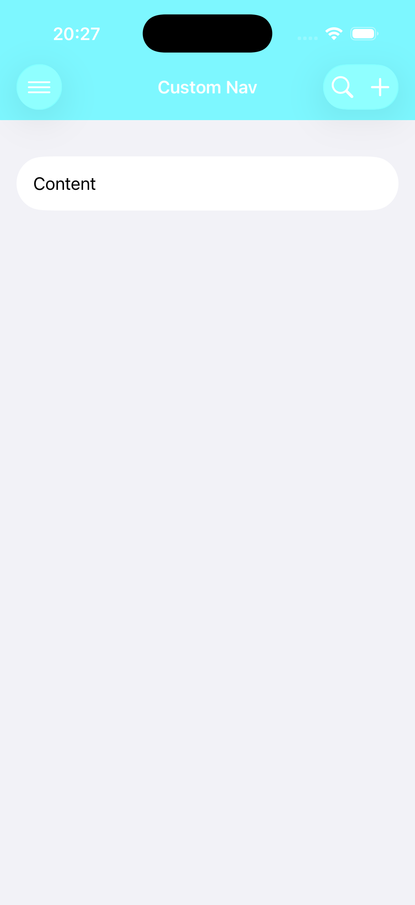
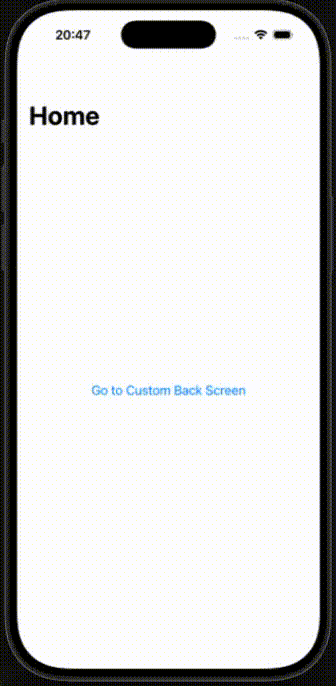

# SimpleNavigation

 Navigation API のサンプル集。--


### SimpleNav

* `NavigationStack` と `NavigationLink` だけで作ったシンプルなナビゲーション。  
* 画面遷移ロジック は `NavigationLink` 内部にあり、`NavigationLink` をクリックしないと動作しない。よって遷移元の画面は `NavigationLink` を使って構築する必要がある。  

#### NavigationLink.init() のシグネチャ

`NavigationLink()` の引数 `destination` に遷移先の画面を渡す。 

```swift
public init(_ titleKey: LocalizedStringKey, @ViewBuilder destination: () -> Destination)
```

#### コード

<table style="width: 100%;">
<tr>
<td style="width: 70%; vertical-align: top;">

``` swift
import SwiftUI

struct SimpleNav: View {
    var body: some View {
        NavigationStack {
            List {
                NavigationLink("Go to Detail") {
                    DetailView()
                }

                NavigationLink {
                    SettingsView()
                } label: {
                    Label("Settings", systemImage: "gear")
                }
            }
            .navigationTitle("Home")
        }
    }
}

struct DetailView: View {
    var body: some View {
        Text("Detail View")
            .navigationTitle("Detail")
    }
}

struct SettingsView: View {
    var body: some View {
        Text("Settings View")
            .navigationTitle("Settings")
    }
}
```

</td>
<td style="width: 30%; vertical-align: top;">



</td>
</tr>
</table>

### DestinationNav

* `.navigationDestination()` Modifier に 遷移先の View を指定する。  
* 画面遷移ロジック は `NavigationLink` 内部にあり、`NavigationLink` をクリックしないと動作しない。よって遷移元の画面は `NavigationLink` を使って構築する必要がある。  

#### NavigationLink.init() のシグネチャ 

SimpleNav とは違い、 `NavigationLink()` の引数に遷移先の `View` を渡さない。 
遷移先の View は `.navigationDestination()` Modifier の第２引数 `destination` に渡す。

``` swift
nonisolated public init<P>(value: P?, @ViewBuilder label: () -> Label) where P : Hashable
````

<table style="width: 100%;">
<tr>
<td style="width: 70%; vertical-align: top;">

#### コード

``` swift
import SwiftUI

struct Item: Identifiable, Hashable {
    let id = UUID()
    let name: String
    let description: String
}

struct DestinationNav: View {
    let items = [
        Item(name: "Item 1", description: "Description 1"),
        Item(name: "Item 2", description: "Description 2"),
        Item(name: "Item 3", description: "Description 3")
    ]
    var body: some View {
        NavigationStack {
            List(items) { item in
                NavigationLink(value: item) {
                    Text(item.name)
                }
            }
            .navigationTitle("Items")
            .navigationDestination(for: Item.self) { item in
                ItemDetailView(item: item)
            }
        }
    }
}

struct ItemDetailView: View {
    let item: Item
    var body: some View {
        VStack {
            Text(item.name)
                .font(.largeTitle)
            Text(item.description)
                .foregroundColor(.secondary)
        }
        .navigationTitle(item.name)
    }
}
```

</td>
<td style="width: 30%; vertical-align: top;">



</td>
</tr>
</table>


### PathNav

* `.navigationDestination()` Modifier に 遷移先の View を指定する。  
* `NavigationPath` オブジェクトが更新すると `.navigationDestination()` Modifier のクロージャが発火する。つまり、プログラマティックに画面遷移イベントを発生させることができる。
* 遷移先は Binding<NavigationPath> オブジェクトを使って遷移を制御することが可能 

#### NavigationStack.init() のシグネチャ

```swift
 @MainActor @preconcurrency public init(path: Binding<NavigationPath>, @ViewBuilder root: () -> Root) where Data == NavigationPath
 ```

<table style="width: 100%;">
<tr>
<td style="width: 70%; vertical-align: top;">

#### コード

```swift
import SwiftUI

struct PathNav: View {
    @State private var path = NavigationPath()

     var body: some View {
        NavigationStack(path: $path) {
            VStack(spacing: 20) {
                Button("Go to Screen A") {
                    path.append("A")
                }
                Button("Go to Screen B") {
                    path.append("B")
                }
                Button("Go to A then B") {
                    path.append("A")
                    path.append("B")
                }
                Button("Go Deep (A → B → C)") {
                    path.append("A")
                    path.append("B")
                    path.append("C")
                }
            }
            .navigationTitle("Home")
            .navigationDestination(for: String.self) { value in
                ScreenView(name: value, path: $path)
            }
        }
    }
}

struct ScreenView: View {
    let name: String
    @Binding var path: NavigationPath
    var body: some View {
        VStack(spacing: 20) {
            Text("Screen \(name)")
                .font(.largeTitle)
            Button("Go Back to Root") {
                path.removeLast(path.count)
            }
            Button("Pop One") {
                path.removeLast()
            }
        }
        .navigationTitle("Screen \(name)")
    }
}
```

</td>
<td style="width: 30%; vertical-align: top;">



</td>
</tr>
</table>

### MultiScreenPathNav

* API の使い方は PathNav と同じ  
* `NavigationStack()` に渡す path に遷移先タイプと遷移先に渡したデータを設定する。 

#### NavigationStack.init() のシグネチャ  

`path` の型が PathNav で使用する `init()` と異なる。  

```swift
@MainActor @preconcurrency public init(path: Binding<Data>, @ViewBuilder root: () -> Root) where Data : MutableCollection, Data : RandomAccessCollection, Data : RangeReplaceableCollection, Data.Element : Hashable
```

<table style="width: 100%;">
<tr>
<td style="width: 70%; vertical-align: top;">

#### コード

```swift
import SwiftUI

enum Destination: Hashable {
    case profile(User)
    case settings
    case detail(DetailItem)
}

struct User: Hashable {
    let id: Int
    let name: String
}

struct DetailItem: Hashable {
    let id: Int
    let name: String
    let description: String
}

struct MultiScreenPathNav: View {
    // NOTE: NavigationPath vs [Destination]()
    //   ・NavigationPath is type-erased it can hold any Hashable value. Good for heterogeneous navigation.
    //   ・Typed arrays like [Destination] are strongly typed better for compile-time safety when all destinations are known.
    @State private var path = [Destination]()
    
    var body: some View {
        NavigationStack(path: $path) {
            List {
                Button("Profile") {
                    path.append(.profile(User(id: 1, name: "John")))
                }
                Button("Settings") {
                    path.append(.settings)
                }
            }
            .navigationTitle("Home")
            .navigationDestination(for: Destination.self) { destination in
                switch destination {
                case .profile(let user):
                    ProfileScreen(user: user) { item in
                        path.append(.detail(item))
                    }
                case .settings:
                    Text("Settings")
                case .detail(let item):
                    DetailScreen(item: item)
                }
            }
        }
    }
}

struct ProfileScreen: View {
    let user: User
    let onDetailTapped: (DetailItem) -> Void
    var body: some View {
        VStack {
            Text(user.name)
                .font(.largeTitle)
            Text(String(user.id))
                .foregroundColor(.secondary)
            Button("詳細") {
                let item = DetailItem(
                    id: user.id,
                    name: user.name,
                    description: "\(user.name)の詳細情報"
                )
                onDetailTapped(item)
            }
            .buttonStyle(.borderedProminent)
            .padding(.top)
        }
        .navigationTitle(user.name)
    }
}

struct DetailScreen: View {
    let item: DetailItem
    var body: some View {
        VStack {
            Text(item.name)
                .font(.largeTitle)
            Text(item.description)
                .foregroundColor(.secondary)
        }
        .navigationTitle("\(item.name)の詳細")
    }
}
```

</td>
<td style="width: 30%; vertical-align: top;">



</td>
</tr>
</table>

### CustomNavigationBarNav

ナビゲーションバーをカスタマイズする。

#### 

<table style="width: 100%;">
<tr>
<td style="width: 70%; vertical-align: top;">

#### コード

```swift
import SwiftUI

struct CustomNavigationBarNav: View {
    var body: some View {
        NavigationStack {
            List {
                Text("Content")
            }
            .navigationTitle("Custom Nav")
            // .inline: タイトルをナビゲーションバー内に小さく表示（iOS 14以降のデフォルト）
            // .large: タイトルを大きく表示（スクロール時に縮小）
            // .automatic: 前の画面の設定を継承
            .navigationBarTitleDisplayMode(.inline)
            .toolbar {
                ToolbarItem(placement: .navigationBarLeading) {
                    Button {
                        // TODO: Action
                    } label: {
                        Image(systemName: "line.horizontal.3")
                    }
                }

                ToolbarItem(placement: .navigationBarTrailing) {
                    HStack {
                        Button {
                            // TODO: Action
                        } label: {
                            Image(systemName: "magnifyingglass")
                        }
                        Button {
                            // TODO: Action
                        } label: {
                            Image(systemName: "plus")
                        }
                    }
                }
            }
            .toolbarBackground(.visible, for: .navigationBar)
            .toolbarBackground(Color.blue, for: .navigationBar)
            // .dark: ナビゲーションバーをダークモードに（アイコンやテキストが明るい色）
            // .light: ライトモードに（アイコンやテキストが暗い色）
            // .automatic: システムの設定に従う
            .toolbarColorScheme(.dark, for: .navigationBar)
        }
    }
}
```

</td>
<td style="width: 30%; vertical-align: top;">



</td>
</tr>
</table>

### CustomBackButtonNav

戻るボタンをカスタマイズする。

#### 

<table style="width: 100%;">
<tr>
<td style="width: 70%; vertical-align: top;">

#### コード

```swift
import SwiftUI

struct CustomBackButtonNav: View {
    @State private var path = NavigationPath()

     var body: some View {
        NavigationStack(path: $path) {
            VStack(spacing: 20) {
                Button("Go to Custom Back Screen") {
                    path.append("CustomBack")
                }
            }
            .navigationTitle("Home")
            .navigationDestination(for: String.self) { screen in
                switch screen {
                case "CustomBack":
                    CustomBackButtonScreen(path: $path)
                default:
                    EmptyView()
                }
            }
        }
    }
}

struct CustomBackButtonScreen: View {
    @Binding var path: NavigationPath

     var body: some View {
        Text("Custom Back Button Screen")
            .navigationBarBackButtonHidden()
            .toolbar {
                ToolbarItem(placement: .navigationBarLeading) {
                    Button {
                        path.removeLast()
                    } label: {
                        HStack {
                            Image(systemName: "chevron.left")
                            Text("Back")
                        }
                    }
                }
            }
            .navigationTitle("Custom Back Button")
    }
}
```

</td>
<td style="width: 30%; vertical-align: top;">



</td>
</tr>
</table>